  

<em>Curiosity is the beginning of every good solution.</em>

<picture>
  <source media="(prefers-color-scheme: dark)" srcset="./assets/divider-dark.svg" />
  
</picture>

## ☾ About Me

I'm a Brazilian Software Developer working at the intersection of software engineering, artificial intelligence, and scientific research.

I hold a degree in Systems Analysis and Development from FATEC and currently work with SaaS applications, software development, automated testing, and AI integration.

My academic background includes undergraduate research in computer vision and intelligent monitoring systems. I'm particularly interested in machine learning, intelligent agents, software architecture, and robotics.

I enjoy understanding how systems work, questioning existing solutions, and transforming complex problems into practical applications.

## ✦ Software Engineering & Applied AI

- Development and maintenance of SaaS applications, across backend and full-stack work
- REST API and database integration
- Automated E2E and regression testing with Playwright, running in continuous integration workflows
- Technical investigation and software troubleshooting
- Built an AI-powered bug triage agent to support the N2 support team
- Collaborated on an intelligent customer support system, from user interaction down to code implementation
- Earlier experience in product management and technical support

## ✧ Tech Stack

✦ used professionally &nbsp;·&nbsp; ☽ academic & project experience &nbsp;·&nbsp; ✧ introductory familiarity

**Programming Languages** 
 
✦ TypeScript · JavaScript · Python &nbsp;&nbsp;☽ Java · SQL · C# &nbsp;&nbsp;✧ C

**Backend & Software Engineering** 
 
✦ Spring Boot · Spring MVC · FastAPI · REST APIs · WebSocket &nbsp;&nbsp;☽ .NET

**Frontend** 
 
✦ React · HTML5 · CSS3 · Sass

**Databases** 
 
☽ MySQL · MongoDB

**Artificial Intelligence & Computer Vision** 
 
✦ AI Agents &nbsp;&nbsp;☽ OpenCV · YOLO / Ultralytics · MediaPipe · InsightFace · NumPy

**Testing & Development Tools** 
 
✦ Playwright · Git · GitHub · Continuous Integration &nbsp;&nbsp;☽ Docker

**Cloud & Hardware** 
 
☽ Raspberry Pi &nbsp;&nbsp;✧ Amazon Web Services · AWS Elastic Beanstalk · Microsoft Azure · Arduino

## ☽ Research & Academic Background

**FATEC CityLab Security** · *2024–2026* 
Undergraduate Research I & II · Final Graduation Project

Research and development of intelligent monitoring systems using artificial intelligence, computer vision, and real-time video processing.

| Focus areas | |
|---|---|
| ✦ Facial recognition | ✦ Real-time image processing |
| ✦ Person detection | ✦ Intelligent monitoring systems |
| ✦ Gesture analysis | ✦ Client-server architecture |
| ✦ Edge computing with Raspberry Pi | |

Presented a short paper at the **VIII Congresso de Inovação e Tecnologia e Workshop de Iniciação Científica e Tecnológica** (8th Congress on Innovation and Technology & Undergraduate Research Workshop).

## ✦ Research Interests

  

Areas I'm actively studying and exploring, not formal specializations.

## ✧ Education & Credentials

| | Credential | Issuer | Year |
|---|---|---|---|
| ☾ | Degree in Systems Analysis and Development | FATEC Rio Preto | 2026 |
| ✦ | AWS Academy Graduate – Cloud Foundations | AWS Academy | 2026 |
| ✦ | Cambridge English B2 First (FCE) | Cambridge English | 2025 |

AWS Academy Graduate is a course-completion credential from the AWS Academy program. It is not the AWS Certified Cloud Practitioner exam certification.

## ☾ GitHub Activity

  
  

## ✦ Let's Connect

  
  

 

  

